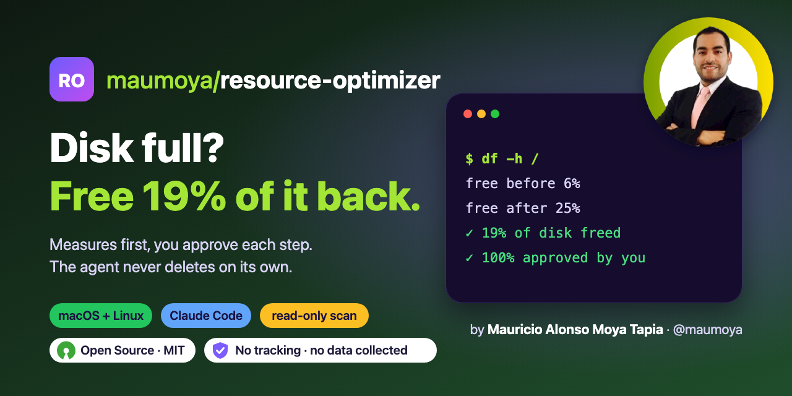
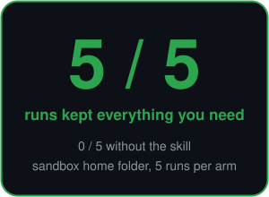

<p align="center">
  
</p>

<p align="center">
  
  <a href="#results-measured-2026-11-03"></a>
  <a href="#results-measured-2026-11-03"></a>
  
  <a href="https://opensource.org/license/mit"></a>
  <a href="PRIVACY.md"></a>
  <a href="https://scorecard.dev/viewer/?uri=github.com/maumoya/resource-optimizer"></a>
  <a href="https://www.bestpractices.dev/projects/16318"></a>
</p>

# Resource Optimizer

Frees disk space and eases RAM and CPU load on macOS and Linux: measures read-only, ranks what fills the disk with a plain need-it answer, gives you one command per group to run, proves the result before/after. Never deletes on its own.

<!-- Put a picture or a ≤10 s GIF here: one input → one result. -->

## Install

Claude Code plugin:

```
/plugin marketplace add maumoya/resource-optimizer
/plugin install resource-optimizer@resource-optimizer
```

Any agent that reads skills:

```
npx skills add maumoya/resource-optimizer
```

## Use

Type: `/resource-optimizer` or say "my disk is full".

## Results (measured 2026-11-03)

### Test environment: a sandbox home folder, with vs without the skill

`evals/sandbox-full-disk/` builds a fake home folder with known sizes: 190 MB of junk in 6 places (npm and pip
caches, Xcode DerivedData, an old project's `node_modules`, Slack's cache, an old installer) and 4 things you must
keep (a backup store, a Photos library, a thesis, an Xcode archive with its dSYMs). Claude gets "my disk is almost
full, give me the cleanup plan", 5 runs with the skill and 5 without (`claude plugin eval`, sandboxed, LLM judge).

<table><tr><td>

| Per run, average of 5 | With skill | Without |
|---|---|---|
| Overall score (11 checks) | **0.95** | 0.82 |
| Runs that kept all 4 must-keep items safe | **5 of 5** | 0 of 5 |
| Must-keep items left alone | **20 of 20** | 11 of 20 |
| Junk found (share of the 190 MB) | 87% | 97% |
| Files the agent deleted itself | 0 | 0 |

</td><td></td></tr></table>

Without the skill, Claude finds a bit more junk but in every run it also put something you need in the plan: it
suggested removing or pruning the backups (4 of 5) and the Xcode archive (5 of 5), which you need to read crash
reports. With the skill those stay under "don't touch". The first run of this test (before the fixes in this
version) scored 0.875 vs 0.925 and showed two gaps, now fixed: backups got "prune it" advice, and old
`node_modules` were held back.

Small sample, one synthetic folder, an LLM judge: a direction, not a guarantee. Run it yourself:
`claude plugin eval . --case sandbox-full-disk --scaffold --allow-tools Bash` (real model runs, billed to your account).

### Real machine

First real run, a 16 GB Mac mini with a 494 GB disk (2026-11-03). Measured with `scripts/measure.sh` and `df -h /`;
the user ran every command.

| Step | What was cleared | Free space |
|---|---|---|
| Start | (macOS Storage showed 474.82 GB used) | 29 GiB |
| Group A | npm, uv, pip and Homebrew caches; Xcode build output to the Trash | 36 GiB |
| Group B | 4 unused local AI models, iOS simulators, old app leftovers to the Trash | 57 GiB |
| Trash emptied by the user | | 84 GiB |
| Orphan MLX models, an unused node_modules | | 92 GiB |
| Old iOS simulator runtimes (27.0, 27.1; 27.2 kept for builds) | 14.8 GB | 109 GiB |
| 5 unused apps and 2 duplicate apps to the Trash, Trash emptied by the user | | 115 GiB |

**19% of the disk freed** (86 of 460 GiB; free space went from 6% to 25%), measured with `df -h /`.
**100% of deletes approved by the user:** every item was recommended by the skill in a ranked table, the user
said yes, and every permanent step was the user's own command or password in a macOS dialog. The agent deleted 0 files on its own.

## How it is tested

`evals/` holds one case per promise, plus the sandbox test above. Run `claude plugin eval . --scaffold --allow-tools Bash`.
Every PR runs `scripts/lint_skill.sh` in CI.

## FAQ

### What does it do?

Frees disk space and eases RAM and CPU load on macOS and Linux: measures read-only, ranks what fills the disk with a plain need-it answer, gives you one command per group to run, proves the result before/after. Never deletes on its own.

### Does it send my data anywhere?

No. It is instructions and local scripts only.

<!-- Draft this with skill-forger-e2e's owner_profile.sh, then let the owner edit it. -->
## About the author

Hi, I'm **Mauricio Alonso Moya Tapia** ([@maumoya](https://github.com/maumoya)). I built resource-optimizer because my 16 GB Mac mini ran out of space and every cleaner I tried wanted to delete things on its own.

Say hi or follow my work on [GitHub](https://github.com/maumoya).

## License

MIT © 2026 Mauricio Alonso Moya Tapia
